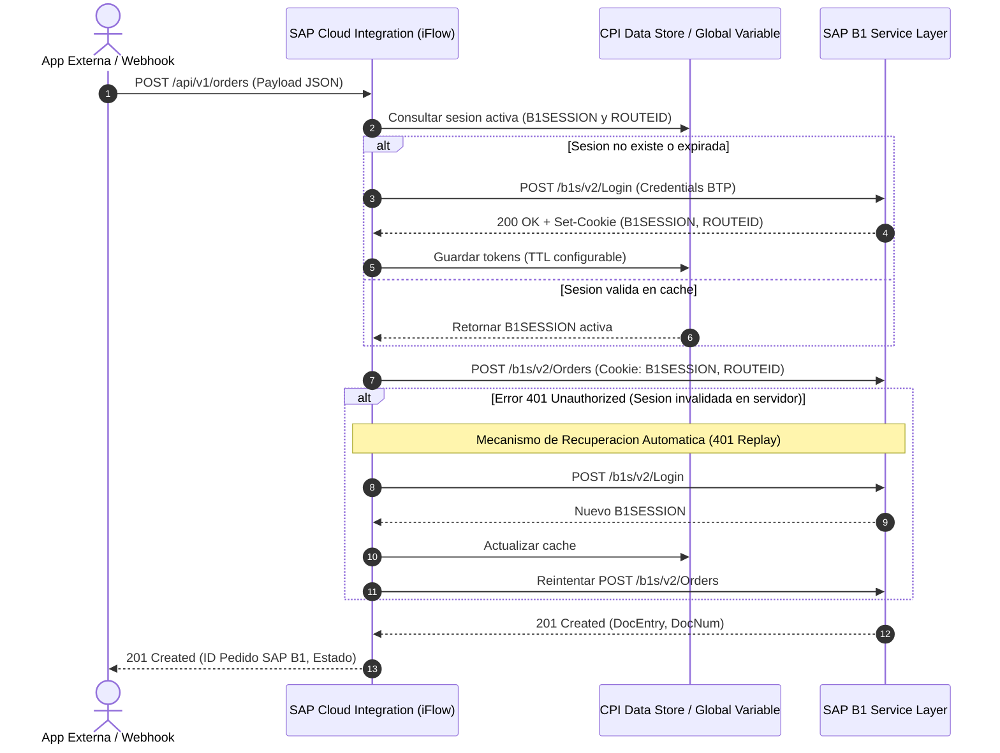

# 🚀 SAP BTP Integration Suite (CPI) ⟷ SAP Business One Service Layer Hub

[](https://cloudplatform.sap.com)
[](https://help.sap.com/viewer/p/SAP_BUSINESS_ONE)
[](https://opensource.org/licenses/MIT)
[](https://www.sap.com/clean-core)

> **Patrón de integración empresarial de referencia para conectar aplicaciones externas, e-commerce, CRM o SAP S/4HANA con SAP Business One (SQL / HANA) a través de SAP Cloud Integration (CPI) y el Service Layer.**

---

## 🎯 Por qué existe este proyecto (El problema del mercado)

Muchas integraciones tradicionales con SAP Business One recurren a:
- Conexiones directas a base de datos (ODBC/JDBC/SQL), lo que **rompe las garantías de soporte de SAP** y viola los principios de *Clean Core*.
- Llamadas directas al Service Layer desde clientes front-end sin capa intermedia de gobernanza, exponiendo credenciales maestras y saturando el servidor con sesiones huérfanas (`B1SESSION`).

### La solución: Arquitectura Desacoplada en SAP BTP
Este proyecto implementa una capa de integración empresarial gestionada sobre **SAP Integration Suite** que resuelve:
1. **Manejo Inteligente de Sesiones**: Reutilización de cookies `B1SESSION` y `ROUTEID` mediante variables globales y almacenamiento en caché para evitar la sobrecarga del Service Layer.
2. **Resiliencia ante Expiración (401 Re-Login Pattern)**: Detección automática de sesiones vencidas, renovación transparente del token y reenvío de la transacción sin intervención del usuario.
3. **Desacoplamiento y Seguridad**: Las credenciales de B1 se almacenan de forma segura en **SAP BTP Destinations / Security Material**, nunca en código ni en el cliente.
4. **Transformación y Mapeo**: Validación de esquemas y normalización entre formatos externos (REST/JSON) y estructuras OData de SAP B1 (`Orders`, `BusinessPartners`, `Invoices`).

---

## 🏛️ Arquitectura del Flujo



---

## 📁 Estructura del Repositorio

```text
proyecto-1-b1-integration-suite/
├── .github/
│   └── workflows/
│       └── ci.yml                 # Pipeline CI para validación y testing
├── docs/
│   ├── arquitectura.md            # Especificación técnica detallada y diagramas
│   └── setup-destination.md       # Guía de configuración de SAP BTP Destination
├── iflows/
│   ├── scripts/
│   │   ├── SessionCacheManager.groovy  # Lógica Groovy para caché de sesión B1
│   │   ├── Handle401Retry.groovy       # Manejo de reintentos en caso de sesión caducada
│   │   └── PayloadTransformer.groovy   # Normalización y mapeo de datos hacia B1
│   └── B1_Integration_Package.md       # Parámetros y configuración del paquete CPI
├── mock-service-layer/            # Servidor local Node.js/TS para simular B1
│   ├── src/
│   │   ├── controllers/
│   │   ├── server.ts
│   │   └── mock-data.ts
│   ├── package.json
│   └── tsconfig.json
└── README.md
```

---

## 🚀 Guía de Inicio Rápido

### Opción A: Pruebas Locales (Sin servidor B1 físico)
Hemos incluido un **Mock Service Layer** en TypeScript que emula exactamente los endpoints de autenticación, pedidos y socios de negocio de SAP Business One:

1. Ingresa a la carpeta del mock:
   ```bash
   cd mock-service-layer
   npm install
   npm run dev
   ```
2. El servidor arrancará en `http://localhost:3000/b1s/v2`.
3. Soporta `POST /Login`, `POST /Orders`, `GET /BusinessPartners` y simulación de expiración de sesión para pruebas de resiliencia.

### Opción B: Despliegue en SAP BTP (Cloud Integration)
1. **Configurar el Destination**: Sigue la guía en [`docs/setup-destination.md`](docs/setup-destination.md) para registrar tu Service Layer en el BTP Cockpit.
2. **Importar el iFlow**: En tu tenant de SAP Integration Suite, crea un paquete de integración e incorpora los scripts Groovy ubicados en [`iflows/scripts/`](iflows/scripts/).
3. **Desplegar**: Despliega el iFlow y obtén el endpoint HTTPS generado por BTP.

---

## 🔒 Buenas Prácticas de Seguridad y Clean Core

* **Sin credenciales hardcodeadas**: Todo acceso utiliza autenticación básica o tokens delegados mediante *BTP Credential Store / Destinations*.
* **Idempotencia**: Se implementa un encabezado `X-Correlation-ID` para evitar la duplicación de órdenes ante interrupciones de red.
* **Trazabilidad en tiempo real**: Registro de auditoría y métricas de ejecución listos para monitoreo en el *SAP Cloud Integration Operations Dashboard*.

---

## 👨‍💻 Autor y Contacto
* **Desarrollador**: Gonzalo Rafael Godoy Alarcón
* **Especialidad**: SAP BTP Integration Suite | Cloud Application Programming (CAP) | SAP Business One
* **LinkedIn**: [Tu perfil de LinkedIn]
